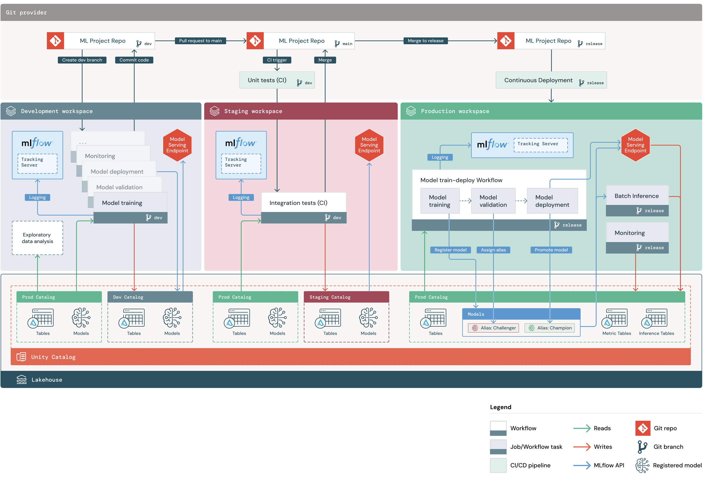

# PROJECT_NAME_CHANGE_ME

This directory contains an ML project based on the default
[Databricks MLOps Stacks](https://github.com/databricks/mlops-stacks),
defining a production-grade ML pipeline for automated retraining and batch inference of an ML model on tabular data.
The "Getting Started" docs can be found at https://learn.microsoft.com/azure/databricks/dev-tools/bundles/mlops-stacks.

See the full pipeline structure below. The [MLOps Stacks README](https://github.com/databricks/mlops-stacks/blob/main/Pipeline.md)
contains additional details on how ML pipelines are tested and deployed across each of the dev, staging, prod environments below.




## Code structure
This project contains the following components:

| Component                  | Description                                                                                                                                                                                                                                                                                                                                             |
|----------------------------|---------------------------------------------------------------------------------------------------------------------------------------------------------------------------------------------------------------------------------------------------------------------------------------------------------------------------------------------------------|
| ML Code                    | Example ML project code, with unit tested Python modules and notebooks                                                                                                                                                                                                                                                                             |
| ML Resources as Code | ML pipeline resources (training and batch inference jobs with schedules, etc) configured and deployed through [databricks CLI bundles](https://learn.microsoft.com/azure/databricks/dev-tools/cli/bundle-cli)                                                                                              |
| CI/CD                      | [GitHub Actions](https://github.com/actions) workflows  to test and deploy ML code and resources
                                |

contained in the following files:

```
PROJECT_NAME_CHANGE_ME        <- Root directory. Both monorepo and polyrepo are supported.
│
├── PROJECT_NAME_CHANGE_ME       <- Contains python code, notebooks and ML resources related to one ML project. 
│   │
│   ├── requirements.txt        <- Specifies Python dependencies for ML code (for example: model training, batch inference).
│   │
│   ├── databricks.yml          <- databricks.yml is the root bundle file for the ML project that can be loaded by databricks CLI bundles. It defines the bundle name, workspace URL and resource config component to be included.
│   │
│   ├── training                <- Training folder contains Notebook that trains and registers the model with feature store support.
│   │
│   ├── validation              <- Optional model validation step before deploying a model.
│   │
│   ├── monitoring              <- Model monitoring, feature monitoring, etc.
│   │
│   ├── deployment              <- Deployment and Batch inference workflows
│   │   │
│   │   ├── batch_inference     <- Batch inference code that will run as part of scheduled workflow.
│   │   │
│   │   ├── model_deployment    <- As part of CD workflow, deploy the registered model by assigning it the appropriate alias.
│   │
│   │
│   ├── tests                   <- Unit tests for the ML project, including the modules under `features`.
│   │
│   ├── resources               <- ML resource (ML jobs, MLflow models) config definitions expressed as code, across dev/staging/prod/test.
│       │
│       ├── model-workflow-resource.yml                <- ML resource config definition for model training, validation, deployment workflow
│       │
│       ├── batch-inference-workflow-resource.yml      <- ML resource config definition for batch inference workflow
│       │
│       ├── ml-artifacts-resource.yml                  <- ML resource config definition for model and experiment
│       │
│       ├── monitoring-resource.yml           <- ML resource config definition for quality monitoring workflow
│
├── .github                     <- Configuration folder for CI/CD using GitHub Actions.  The CI/CD workflows deploy ML resources defined in the `./resources/*` folder with databricks CLI bundles.
│
├── docs                        <- Contains documentation for the repo.
```

## Using this repo

The table below links to detailed docs explaining how to use this repo for different use cases.


This project comes with example ML code to train, validate and deploy a regression model to predict NYC taxi fares.
If you're a data scientist just getting started with this repo for a brand new ML project, we recommend 
adapting the provided example code to your ML problem. Then making and 
testing ML code changes on Databricks or your local machine. Follow the instructions from
the [project README](./PROJECT_NAME_CHANGE_ME/README.md).
 

When you're ready to deploy production training/inference
pipelines, ask your ops team to follow the [MLOps setup guide](docs/mlops-setup.md) to configure CI/CD and deploy 
production ML pipelines.

After that, follow the [ML pull request guide](docs/ml-pull-request.md)
 and [ML resource config guide](PROJECT_NAME_CHANGE_ME/resources/README.md)  to propose, test, and deploy changes to production ML code (e.g. update model parameters)
or pipeline resources (e.g. use a larger instance type for model training) via pull request.

| Role                          | Goal                                                                         | Docs                                                                                                                                                                |
|-------------------------------|------------------------------------------------------------------------------|---------------------------------------------------------------------------------------------------------------------------------------------------------------------|
| Data Scientist                | Get started writing ML code for a brand new project                          | [project README](./PROJECT_NAME_CHANGE_ME/README.md) |
| MLOps / DevOps                | Set up CI/CD for the current ML project   | [MLOps setup guide](docs/mlops-setup.md)                                                                                                                            |
| Data Scientist                | Update production ML code (e.g. model training logic) for an existing project | [ML pull request guide](docs/ml-pull-request.md)                                                                                                                    |
| MLOps Engineer                | Modify production model ML resources, e.g. model training or inference jobs  | [ML resource config guide](PROJECT_NAME_CHANGE_ME/resources/README.md)  |